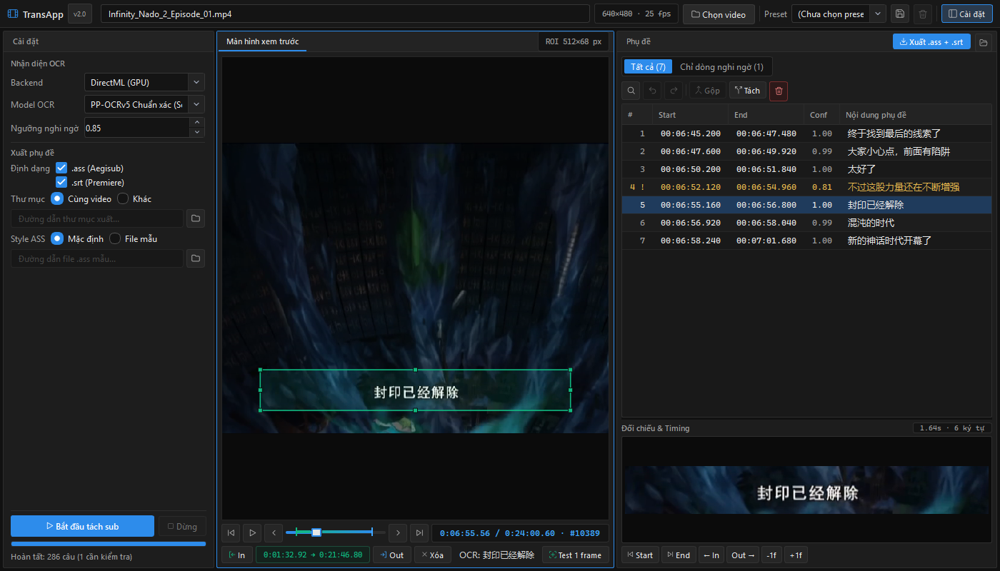

<div align="center">

# TransApp

**Frame-accurate Simplified Chinese / CJK hardsub extractor for Windows**  
*Adobe Premiere Pro / After Effects inspired workbench · 2-Stage `ch_PP-OCRv5` (DirectML GPU / CPU) · Aegisub `.ass` & Premiere Pro `.srt`*

[](https://github.com/wanngxuanji/Trans-APP/actions/workflows/ci.yml)
[](https://github.com/wanngxuanji/Trans-APP/releases)
[](#download--quick-start)
[](pyproject.toml)
[](LICENSE)

<br>



</div>

---

## Overview

**TransApp** is a native Windows desktop application built with PySide6, PyAV, and RapidOCR (`ch_PP-OCRv5`) for fansubbers and video editors who need **frame-accurate hardcoded subtitle extraction** from anime, donghua, and CJK video episodes.

Unlike generic OCR scripts that drift across NTSC frame rates (`23.976` / `29.97 fps`), glue back-to-back dialogue lines, or drop short 2-character cues over fast action scenes, TransApp combines a **native 4D ONNX-batched detector + single-pass ring-buffer refinement** with **Aegisub/libass inter-frame midpoint centisecond snapping** inside a distraction-free, keyboard-first NLE workbench.

> **Tóm tắt nhanh (Tiếng Việt):** Tải file **`TransApp-v2.0.0-win64-portable.zip`** trong mục [**Releases**](https://github.com/wanngxuanji/Trans-APP/releases), giải nén và chạy trực tiếp **`TransApp.exe`** (không cần cài Python). Lần chạy đầu tiên app sẽ tự tải model `ch_PP-OCRv5` vào thư mục `models/` ngay cạnh `TransApp.exe`. Quy trình: **Mở video → Kéo khung ROI quanh vùng phụ đề → Đặt In/Out cắt OP/ED (tuỳ chọn) → Bắt đầu tách sub → Rà & đồng bộ mốc ngay trên bảng → Xuất `.ass` / `.srt`**.

---

## Download & Quick Start

### Option 1 — Windows Portable Release (Recommended, No Python Required)

1. Download **`TransApp-v2.0.0-win64-portable.zip`** (and optional `SHA256SUMS.txt`) from [**GitHub Releases**](https://github.com/wanngxuanji/Trans-APP/releases).
2. Extract to any writable folder (e.g. `D:\Tools\TransApp\`).
3. Double-click **`TransApp.exe`**.

> **First-run OCR models:** On first extraction (or `Test 1 frame`), TransApp automatically downloads the selected `ch_PP-OCRv5` ONNX weights into the portable `models/` folder next to `TransApp.exe` (falling back to `%LOCALAPPDATA%\TransApp\models` if extracted to a read-only location). Subsequent runs are 100% offline.

### Option 2 — Run From Source (Developers)

```powershell
git clone https://github.com/wanngxuanji/Trans-APP.git
cd Trans-APP
python -m venv .venv
.venv\Scripts\python -m pip install -e ".[dev]"
.venv\Scripts\transapp
```

Create a clickable `TransApp.lnk` Windows shortcut (no console window):

```powershell
powershell -ExecutionPolicy Bypass -File scripts\create_shortcut.ps1
# Or create directly on Desktop:
powershell -ExecutionPolicy Bypass -File scripts\create_shortcut.ps1 -Desktop
```

---

## Key Features

### 2-Stage `ch_PP-OCRv5` Precision Pipeline
- **Stage 1 — Frame-Accurate Span Detection:** Native 4D ONNX batching (`[N, 3, H, W]`, `N=16` DirectML / `N=8` CPU) with `ch_PP-OCRv5 Det Mobile`, shared-coordinate `TightSignature` visual matching (immune to DBNet bounding-box jitter on moving backgrounds), and single-pass ring-buffer onset/offset refinement for `±0–1 frame` accuracy across CFR, NTSC (`23.976` / `29.97 fps`), and VFR streams.
- **Stage 2 — Consensus Recognition & Safety Splitting:** Borderless `ch_PP-OCRv5 Server` (default) or `Mobile` (`fast`) recognition with interior-first adaptive early exit, confidence-weighted & character-level consensus voting, selective glare/brightness retry, bounded-stack multi-cue binary-search splitting, and minimal-pair / numeric countdown protection.
- **Automatic DirectML GPU Acceleration:** Uses `onnxruntime-directml` on Windows GPUs (AMD, Intel, NVIDIA) with eager session verification and transparent CPU fallback.

### Premiere Pro / After Effects Docked Workbench
- **3-Pane Horizontal Dock (`Settings | Program Monitor | Subtitles`):** Neutral graphite palette (`#111111` / `#161616` / `#1D1D1D`), collapsible left Settings panel, active-panel Premiere blue focus outline (`#2D8CEB`), and iconic blue Program Monitor timecode + frame index (`0:06:55.60 / 0:23:03.12 · #10390`).
- **Interactive Preview & OP/ED Trim:** Sequential `Play / Pause` (`Space`), hold-to-repeat stepping (`<` / `>`, `←` / `→`, `,` / `.`), VFR-safe single-frame step-back, drag-and-drop video loading, and `In` / `Out` (`I` / `O`) trim that preserves original absolute episode timestamps.
- **Pro-Subber Review Table & QA Inspector:** Video↔Table Start/End sync (`Alt+S` / `Alt+E`), snap-to-playhead (`Ctrl+[` / `Ctrl+]`), exact `frame_pts_ms` `±1f` nudge (zero NTSC rounding drift), `flag_reason` QA banner with auto-clear on edit (`Ctrl+D`), multi-row delete, Merge (`Ctrl+M`), Split (`Ctrl+K`), 50-step Undo/Redo (`Ctrl+Z` / `Ctrl+Y`), and Find & Replace (`Ctrl+F` / `Ctrl+H`).

### Aegisub & Adobe Premiere Pro Export
- **Inter-Frame Midpoint Centisecond Snapping:** Verified against libass rendering semantics so exported `.ass` cues never start 1 frame late or bleed across hard scene cuts.
- **Full Template Preservation:** Order-independent `.ass` template parser supporting UTF-8/UTF-16 templates, `[Fonts]` / `[Graphics]` uuencoded payload preservation, multi-style selector, `{}` & `\N` escaping, strict non-overlap clamping, identical `.ass` / `.srt` cue parity, and atomic file writes.

---

## Subbing Workflow

1. **Load & Frame ROI:** Drag and drop an episode (`.mp4`, `.mkv`, `.ts`, `.avi`, `.mov`, `.webm`) onto the Program Monitor, scrub to a dialogue line, and drag the emerald ROI rectangle around the subtitle band. Save reusable show presets via the top bar.
2. **Trim OP/ED (Optional):** Scrub to the end of the opening and press `I` (`In`), then to the start of the ending and press `O` (`Out`). Click **Test 1 frame** to verify OCR readability.
3. **Extract:** Choose **DirectML (GPU)** or **CPU** and **PP-OCRv5 Server** (accuracy) or **Mobile** (speed), then click **Bắt đầu tách sub**.
4. **Review & Export:** Collapse the Settings panel for a 50/50 Monitor + Subtitles view, filter flagged rows if any, sync boundaries with `Alt+S` / `Alt+E` and `Ctrl+[` / `Ctrl+]`, and export `.ass` + `.srt`.

---

## Keyboard Shortcuts

| Context | Shortcut | Action |
| :--- | :--- | :--- |
| **Transport (Global)** | `Space` | Play / Pause preview |
| | `←` / `→` · `,` / `.` · `<` / `>` | Step `±1` frame (hold to scrub) |
| | `Shift+←` / `Shift+→` | Jump `±1` second |
| | `Ctrl+←` / `Ctrl+→` | Jump `±5` seconds |
| | `Home` / `End` | Jump to start / end of video |
| | `I` / `O` | Set OP/ED trim `In` / `Out` point |
| **Timing Sync & QA** | `Alt+S` / `Alt+E` | Seek video to selected cue Start / End |
| | `Ctrl+[` / `Ctrl+]` | Snap selected cue Start / End to playhead |
| | `Ctrl+D` | Mark selected cue reviewed (clear flag) |
| **Subtitle Table** | `F2` / Double-click | Edit cell inline (`\N` for line breaks) |
| | `Delete` | Delete selected row(s) |
| | `Ctrl+M` | Merge contiguous selected rows |
| | `Ctrl+K` | Split selected row at playhead or midpoint |
| | `Ctrl+Z` / `Ctrl+Y` | Undo / Redo (up to 50 steps) |
| | `Ctrl+F` / `Ctrl+H` | Open Find / Find & Replace bar |

---

## Building the Windows Portable Release

```powershell
.venv\Scripts\python -m pip install -e ".[dev,build]"

# Build standard portable zip (downloads OCR models on first run into ./models)
powershell -ExecutionPolicy Bypass -File scripts\build_release.ps1

# Optional: bundle cached .onnx models from your environment for a 100% offline zip
powershell -ExecutionPolicy Bypass -File scripts\build_release.ps1 -BundleModels
```

Outputs are written to `release/TransApp-v<version>-win64-portable.zip` and `release/SHA256SUMS.txt` after automatically running `dist\TransApp\TransApp.exe --smoke-test`.

---

## Project Structure

```text
TransApp/
├── src/transapp/
│   ├── app.py                  # GUI entry point, --smoke-test, crash logging
│   ├── core/
│   │   ├── video_reader.py     # PTS-accurate PyAV reader, B-frame safe seeks, VFR step-back
│   │   ├── ocr_engine.py       # RapidOCR v3 (ch_PP-OCRv5), 4D ONNX batching, DirectML fallback
│   │   ├── deep_extractor.py   # 2-stage ring-buffer detector & consensus voter
│   │   ├── postprocess.py      # Normalization, merging, minimal-pair guard, QA flagging
│   │   ├── pipeline.py         # End-to-end extraction orchestrator & trim bounds
│   │   ├── paths.py            # Dev vs PyInstaller frozen asset & portable models/ paths
│   │   ├── models.py           # Core dataclasses (RoiRect, ExtractConfig, SubtitleEvent)
│   │   └── presets.py          # Atomic JSON preset persistence
│   ├── exporters/
│   │   ├── sanitize.py         # Libass midpoint snapping, escaping, atomic file writes
│   │   ├── ass_exporter.py     # Order-independent .ass template parser & exporter
│   │   └── srt_exporter.py     # Premiere Pro .srt exporter
│   └── ui/
│       ├── theme.py            # Adobe Premiere/AE graphite tokens & QSS
│       ├── main_window.py      # 3-pane docked workbench, transport, async workers
│       ├── review_table.py     # Editable subtitle table, QA inspector, undo/redo, find/replace
│       ├── roi_canvas.py       # Interactive ROI overlay & drag-and-drop monitor well
│       └── icons.py            # Crisp 1.5px vector SVG icon renderer
├── build/transapp.spec         # PyInstaller --onedir build specification
├── scripts/
│   ├── build_release.ps1       # Portable release builder + smoke test + SHA256
│   └── create_shortcut.ps1     # One-click Windows .lnk launcher generator
├── tests/                      # Full pytest + pytest-qt suite (182 tests, -W error)
└── .github/workflows/          # Windows CI (ci.yml) & tag-triggered GitHub Release (release.yml)
```

---

## Testing & Contributing

```powershell
$env:QT_QPA_PLATFORM='offscreen'
.venv\Scripts\pytest -q -W error
```

See [CONTRIBUTING.md](CONTRIBUTING.md) and [CHANGELOG.md](CHANGELOG.md) for development guidelines and release history.

## License

Released under the [MIT License](LICENSE).
