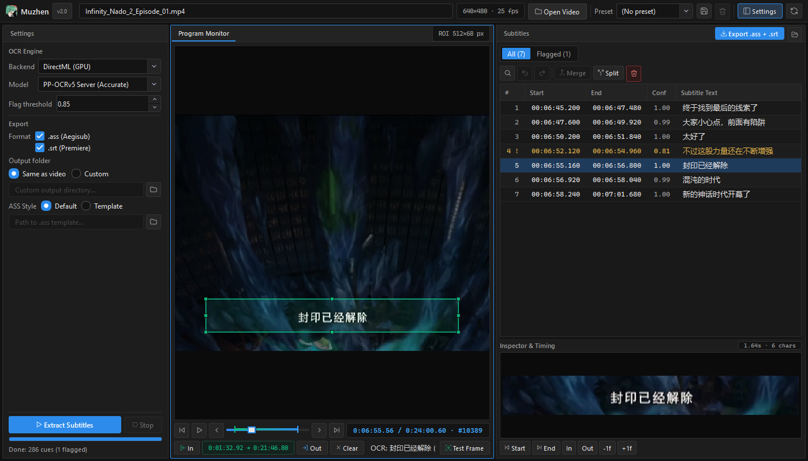

<div align="center">


# Muzhen (`幕帧`)

**Frame-accurate Simplified Chinese / CJK hardsub extractor for Windows**  
*Adobe Premiere Pro / After Effects inspired workbench · 2-Stage `ch_PP-OCRv5` (DirectML GPU / CPU) · Aegisub `.ass` & Premiere Pro `.srt`*

[](https://github.com/wanngxuanji/Muzhen/actions/workflows/ci.yml)
[](https://github.com/wanngxuanji/Muzhen/releases)
[](#system-requirements)
[](pyproject.toml)
[](LICENSE)

<br>



</div>

---

## Overview

**Muzhen (`幕帧` — *Subtitle · Frame*)** is a native Windows desktop workbench built with PySide6, PyAV, and RapidOCR (`ch_PP-OCRv5`) for fansubbers and video editors who need **frame-accurate hardcoded subtitle extraction** from anime, donghua, and CJK video episodes.

Generic OCR scripts routinely drift on NTSC frame rates (`23.976` / `29.97 fps`), glue back-to-back dialogue cuts, or drop short 2-character cues over fast action scenes. Muzhen pairs a **native 4D ONNX-batched detector + single-pass ring-buffer boundary refiner** with **Aegisub/libass inter-frame midpoint centisecond snapping** inside a distraction-free, keyboard-first NLE workbench.

---

## Download & Quick Start

### Option 1 — Windows Portable Release (Recommended, No Python Required)

1. Download **`Muzhen-v2.0.0-win64-portable.zip`** (and optional `SHA256SUMS.txt`) from [**GitHub Releases**](https://github.com/wanngxuanji/Muzhen/releases).
2. Extract to any writable directory (for example `D:\Tools\Muzhen\`).
3. Double-click **`Muzhen.exe`**.

> **First-run OCR models:** On your first extraction (or `Test Frame`), Muzhen automatically downloads the selected `ch_PP-OCRv5` ONNX weights into the portable `models/` directory next to `Muzhen.exe` (falling back to `%LOCALAPPDATA%\Muzhen\models` if extracted to a read-only location). Subsequent runs work 100% offline.

> **Built-in Update Checker:** Muzhen checks GitHub Releases silently in the background on startup (never blocking offline use) and shows a compact **Update** badge in the top bar whenever a newer version is published, with full release notes and **Update Now / Skip This Version / Later** controls. You can also trigger a check manually via the refresh icon in the top bar.

### Option 2 — Run From Source (Developers)

```powershell
git clone https://github.com/wanngxuanji/Muzhen.git
cd Muzhen
python -m venv .venv
.venv\Scripts\python -m pip install -e ".[dev]"
.venv\Scripts\muzhen
```

Create a clickable `Muzhen.lnk` Windows shortcut (no console window):

```powershell
powershell -ExecutionPolicy Bypass -File scripts\create_shortcut.ps1
# Or create directly on Desktop:
powershell -ExecutionPolicy Bypass -File scripts\create_shortcut.ps1 -Desktop
```

---

## System Requirements

| Component | Minimum | Recommended |
| :--- | :--- | :--- |
| **Operating System** | Windows 10 (1903+) 64-bit | Windows 10 / 11 64-bit |
| **CPU** | 64-bit x86_64 quad-core | 6+ cores with AVX2 (for fast CPU fallback) |
| **RAM** | 4 GB | 8 GB+ (1080p episodes) |
| **GPU** | Optional (automatic CPU ONNX Runtime fallback) | Any DirectX 12 GPU (NVIDIA, AMD, Intel Arc/UHD) via **DirectML** |
| **Storage** | ~450 MB extracted app + ~180 MB first-run OCR models | 1 GB+ free SSD space |
| **Display** | 1280×720 | 1920×1080 or higher |
| **Network** | Required once to download `ch_PP-OCRv5` weights (or use `-BundleModels`) | Optional (for automatic GitHub update checks) |
| **Supported Media** | `.mp4`, `.mkv`, `.ts`, `.avi`, `.mov`, `.webm` (H.264, HEVC, VP9, AV1 via bundled PyAV/FFmpeg) | CFR, NTSC (`23.976` / `29.97 fps`), and VFR episodes |

---

## Key Features

### 2-Stage `ch_PP-OCRv5` Precision Pipeline
- **Stage 1 — Frame-Accurate Span Detection:** Native 4D ONNX batching (`[N, 3, H, W]`, `N=16` DirectML / `N=8` CPU) with `ch_PP-OCRv5 Det Mobile`, shared-coordinate `TightSignature` visual matching (immune to DBNet box jitter on fast-moving action backgrounds), and single-pass ring-buffer onset/offset refinement for `±0–1 frame` accuracy across CFR, NTSC, and VFR streams.
- **Stage 2 — Consensus Recognition & Multi-Cue Splitting:** Borderless `ch_PP-OCRv5 Server` (default) or `Mobile` (`fast`) recognition with interior-first adaptive early exit, confidence-weighted & character-level consensus voting, selective glare/brightness retry, bounded-stack multi-cue binary-search splitting, and minimal-pair / numeric countdown protection.
- **Automatic DirectML GPU Acceleration:** Uses `onnxruntime-directml` on Windows GPUs with eager Stage 1 + Stage 2 session verification and seamless CPU fallback.

### Premiere Pro / After Effects Docked Workbench
- **3-Pane Horizontal Dock (`Settings | Program Monitor | Subtitles`):** Neutral graphite palette (`#111111` / `#161616` / `#1D1D1D`), collapsible Settings panel, Premiere-blue active-panel focus outline (`#2D8CEB`), and blue Program Monitor timecode + frame index (`0:06:55.56 / 0:24:00.60 · #10389`).
- **Interactive Preview & OP/ED Trim:** Sequential `Play / Pause` (`Space`), hold-to-repeat stepping (`<` / `>`, `←` / `→`, `,` / `.`), VFR-safe single-frame step-back, drag-and-drop video loading, and `In` / `Out` (`I` / `O`) OP/ED trim preserving original absolute episode timestamps.
- **Pro-Subber Review Table & QA Inspector:** Video↔Table Start/End sync (`Alt+S` / `Alt+E`), snap-to-playhead (`Ctrl+[` / `Ctrl+]`), exact `frame_pts_ms` `±1f` nudge (zero NTSC rounding drift), `flag_reason` QA banner with auto-clear on edit (`Ctrl+D`), multi-row delete, Merge (`Ctrl+M`), Split (`Ctrl+K`), 50-step Undo/Redo (`Ctrl+Z` / `Ctrl+Y`), and Find & Replace (`Ctrl+F` / `Ctrl+H`).

### Aegisub & Adobe Premiere Pro Export
- **Inter-Frame Midpoint Centisecond Snapping:** Verified against libass rendering semantics so exported `.ass` cues never start 1 frame late or bleed across hard scene cuts.
- **Full Template Preservation:** Order-independent `.ass` template parser supporting UTF-8/UTF-16 templates, `[Fonts]` / `[Graphics]` uuencoded payload preservation, multi-style selector, `{}` & `\N` escaping, strict non-overlap clamping, identical `.ass` / `.srt` cue parity, and atomic file writes.

---

## Subbing Workflow

1. **Open & Frame ROI:** Drag and drop an episode onto **Program Monitor** (or click **Open Video**), scrub to a dialogue line, and drag the emerald ROI box around the subtitle area. Save show presets in the top bar for instant reuse.
2. **Trim OP/ED (Optional):** Scrub to the end of the opening and press `I` (**In**), then to the start of the ending and press `O` (**Out**). Click **Test Frame** to verify OCR accuracy before scanning.
3. **Extract:** Select **DirectML (GPU)** or **CPU** and **PP-OCRv5 Server (Accurate)** or **Mobile (Fast)**, then click **Extract Subtitles**.
4. **Review & Export:** Collapse **Settings** for a wide 50/50 **Program Monitor + Subtitles** layout, filter flagged cues if any, fine-tune boundaries with `Alt+S` / `Alt+E` and `Ctrl+[` / `Ctrl+]`, and click **Export .ass + .srt**.

---

## Keyboard Shortcuts

| Context | Shortcut | Action |
| :--- | :--- | :--- |
| **Transport (Global)** | `Space` | Play / Pause preview |
| | `←` / `→` · `,` / `.` · `<` / `>` | Step `±1` frame (hold to scrub) |
| | `Shift+←` / `Shift+→` | Jump `±1` second |
| | `Ctrl+←` / `Ctrl+→` | Jump `±5` seconds |
| | `Home` / `End` | Jump to start / end of video |
| | `I` / `O` | Set OP/ED trim `In` / `Out` point |
| **Timing Sync & QA** | `Alt+S` / `Alt+E` | Seek video to selected cue Start / End |
| | `Ctrl+[` / `Ctrl+]` | Snap selected cue Start / End to playhead |
| | `Ctrl+D` | Mark selected cue reviewed (clear flag) |
| **Subtitle Table** | `F2` / Double-click | Edit cell inline (`\N` for line breaks) |
| | `Delete` | Delete selected row(s) |
| | `Ctrl+M` | Merge contiguous selected rows |
| | `Ctrl+K` | Split selected row at playhead or midpoint |
| | `Ctrl+Z` / `Ctrl+Y` | Undo / Redo (up to 50 steps) |
| | `Ctrl+F` / `Ctrl+H` | Open Find / Find & Replace bar |

---

## Building the Windows Portable Release

```powershell
.venv\Scripts\python -m pip install -e ".[dev,build]"

# Standard portable zip (downloads OCR models on first run into ./models)
powershell -ExecutionPolicy Bypass -File scripts\build_release.ps1

# Optional: bundle cached .onnx weights from your local environment for an offline zip
powershell -ExecutionPolicy Bypass -File scripts\build_release.ps1 -BundleModels
```

Outputs are written to `release/Muzhen-v<version>-win64-portable.zip` and `release/SHA256SUMS.txt` after automatically running `dist\Muzhen\Muzhen.exe --smoke-test`.

---

## Project Structure

```text
Muzhen/
├── src/muzhen/
│   ├── app.py                  # GUI entry point, --smoke-test, crash logging
│   ├── core/
│   │   ├── video_reader.py     # PTS-accurate PyAV reader, B-frame safe seeks, VFR step-back
│   │   ├── ocr_engine.py       # RapidOCR v3 (ch_PP-OCRv5), 4D ONNX batching, DirectML fallback
│   │   ├── deep_extractor.py   # 2-stage ring-buffer detector & consensus voter
│   │   ├── postprocess.py      # Normalization, merging, minimal-pair guard, QA flagging
│   │   ├── pipeline.py         # End-to-end extraction orchestrator & trim bounds
│   │   ├── updater.py          # GitHub Releases semver checker & atomic skip preferences
│   │   ├── paths.py            # Dev vs PyInstaller frozen asset & portable models/ paths
│   │   ├── models.py           # Core dataclasses (RoiRect, ExtractConfig, SubtitleEvent)
│   │   └── presets.py          # Atomic JSON preset persistence
│   ├── exporters/
│   │   ├── sanitize.py         # Libass midpoint snapping, escaping, atomic file writes
│   │   ├── ass_exporter.py     # Order-independent .ass template parser & exporter
│   │   └── srt_exporter.py     # Premiere Pro .srt exporter
│   └── ui/
│       ├── assets/             # Rounded muzhen.ico, muzhen_icon.png, crisp vector SVGs
│       ├── theme.py            # Adobe Premiere/AE graphite tokens & QSS
│       ├── main_window.py      # 3-pane docked workbench, transport, async workers, UpdateDialog
│       ├── review_table.py     # Editable subtitle table, QA inspector, undo/redo, find/replace
│       ├── roi_canvas.py       # Interactive ROI overlay & drag-and-drop monitor well
│       └── icons.py            # Crisp 1.5px vector SVG icon renderer
├── build/muzhen.spec           # PyInstaller --onedir build specification
├── scripts/
│   ├── build_release.ps1       # Portable release builder + smoke test + SHA256
│   └── create_shortcut.ps1     # One-click Windows Muzhen.lnk launcher generator
├── tests/                      # Full pytest + pytest-qt suite (189 tests, -W error)
└── .github/workflows/          # Windows CI (ci.yml) & tag-triggered GitHub Release (release.yml)
```

---

## Testing & Contributing

```powershell
$env:QT_QPA_PLATFORM='offscreen'
.venv\Scripts\pytest -q -W error
```

See [CONTRIBUTING.md](CONTRIBUTING.md) and [CHANGELOG.md](CHANGELOG.md) for development guidelines and release history.

## License

Released under the [MIT License](LICENSE).
